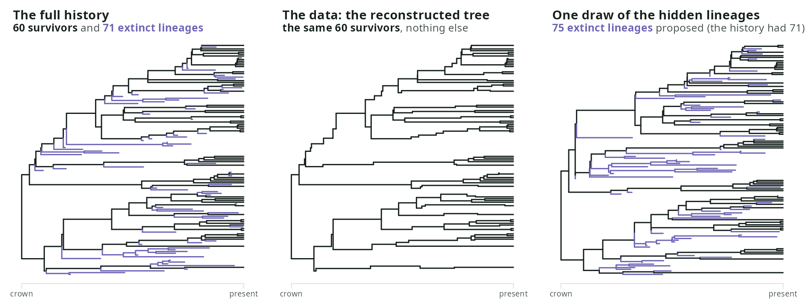
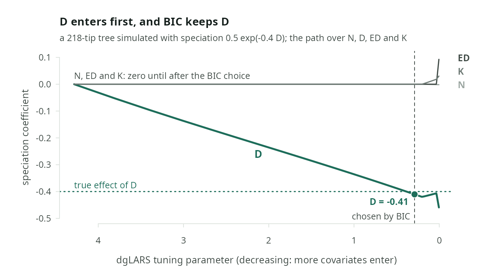

# emphasis

[](https://github.com/franciscorichter/emphasis/actions/workflows/R-CMD-check.yaml)
[](./LICENSE)
[](https://franciscorichter.github.io/emphasis/)

**emphasis** fits birth-death models of species diversification to phylogenetic trees, where the speciation and extinction rate of each lineage depends on quantities the process generates itself: how many lineages are alive, how long a lineage has waited since it last split, how distinct it is on the tree, and how many splits lie in its ancestry.

A reconstructed phylogeny shows only the species alive today. Everything that went extinct is missing, and the rates depend on it. emphasis integrates over those hidden lineages: it samples them onto the observed tree, weights each sample by how well it explains the data, and estimates the rates by Monte Carlo expectation-maximisation.



*A clade simulated under diversity dependence. Left: everything that happened. Middle: the same tree with its extinct lineages removed, which is all a phylogeny of living species records. Right: one set of extinct lineages that emphasis's sampler proposes for that observed tree; a fit averages over hundreds of such draws.*

Version 1.1.0, submitted to CRAN. Documentation: <https://franciscorichter.github.io/emphasis/>.

## Installation

```r
# install.packages("devtools")
devtools::install_github("franciscorichter/emphasis")
```

The package compiles C++ code (Rcpp, RcppParallel, nloptr, BH), so a compiler is needed: Xcode command-line tools on macOS, Rtools on Windows.

## Quick start

```r
library(emphasis)

# simulate a clade under diversity dependence: lambda = 0.6 exp(-0.01 N), mu = 0.05
set.seed(1)
sim <- simulate_tree(pars = c(log(0.6), -0.01, log(0.05), 0), max_t = 10, model = "dd",
                     max_tries = 20)        # redraw until the clade survives
phy <- sim$tes                              # the reconstructed tree, an ape::phylo

# a parameter box for each model, from the tree alone
box_cr <- auto_bounds(phy, model = "cr", train_surv_gam = FALSE)
box_dd <- auto_bounds(phy, model = "dd", train_surv_gam = FALSE)

# fit constant rates and diversity dependence, then compare them
fit_cr <- estimate_rates(phy, model = "cr",
                         control = list(lower_bound = box_cr$lower_bound,
                                        upper_bound = box_cr$upper_bound, sample_size = 200))
fit_dd <- estimate_rates(phy, model = "dd",
                         control = list(lower_bound = box_dd$lower_bound,
                                        upper_bound = box_dd$upper_bound, sample_size = 200))
fit_dd                                      # estimates, log-likelihood, effective sample, stop reason
compare_models(cr = fit_cr, dd = fit_dd)    # AIC with the Monte Carlo diagnostics
```

On a desktop CPU (AMD Ryzen 9) this runs in about 7 minutes. In that run the simulated tree had 97 tips (the compiled simulator draws differently across platforms, so the tree may differ), `compare_models()` chooses `dd` by 4.2 AIC, and the estimate of $\beta_N$ is -0.0102 against the true -0.01.

## The model

Each lineage $s$ alive at time $t$ speciates at rate $\lambda(s,t)$ and goes extinct at rate $\mu(s,t)$:

$$
\lambda(s,t) = f\bigl(\beta_0 + \beta_N N(t) + \beta_D D_s(t) + \beta_{ED}\,\mathrm{ED}_s(t) + \beta_K K_s(t)\bigr),
\qquad
\mu(s,t) = f\bigl(\gamma_0 + \gamma_N N(t) + \dots\bigr)
$$

with $f = \exp$ (the default) or the linear link $f(x) = \max(0, x)$, chosen with `link = "exponential"` or `"linear"`.

| Covariate | What it measures | Biological question |
| --------- | ---------------- | ------------------- |
| $N(t)$ | the number of lineages alive | do ecological limits slow diversification? |
| $D_s(t)$ | the time since lineage $s$ last split, relative to the clade mean | do lineages that have waited longer speciate more or less? |
| $\mathrm{ED}_s(t)$ | evolutionary distinctiveness (fair proportion) on the complete tree | do isolated lineages diversify differently? |
| $K_s(t)$ | the number of speciation events in the ancestry of $s$ | does a speciation-rich ancestry carry on? |

$D$, $\mathrm{ED}$ and $K$ are read on the complete tree, hidden lineages included, so they need the tree's topology (a `phylo`). The [covariates page](https://franciscorichter.github.io/emphasis/covariates/) gives each one's definition and meaning.

Setting coefficients to zero gives the named models:

| Model | Covariates | Model | Covariates |
| ----- | ---------- | ----- | ---------- |
| `"cr"` | none (constant rates) | `"ed"` | $\mathrm{ED}$ |
| `"dd"` | $N$ (diversity dependence) | `"ned"` | $N + \mathrm{ED}$ |
| `"d"` | $D$ | `"edc"`, `"nedc"` | $\mathrm{ED}$ centred on the clade mean, alone or with $N$ |
| `"nd"` | $N + D$ | `"k"`, `"nk"` | $K$, alone or with $N$ |

A formula works too: `model = ~ N + D`, `~ N + ED`, `~ N + EDc`, `~ N + K`.

## What the package does

### Simulate trees

`simulate_tree()` runs the process forward under any model and link, and returns the reconstructed tree (`tes`), the complete tree with its extinct lineages (`tas`) and the L-table. A matrix of parameter rows gives one simulation per row, in parallel. Given an observed tree, it instead draws the hidden lineages from either of the package's two samplers.

```r
sim <- simulate_tree(pars = c(log(0.5), -0.02, log(0.1), 0), max_t = 10, model = "dd")
sim$status                           # "done", "extinct" or "too_large"
plot(sim$tes)

# hidden lineages for an observed tree: 50 draws with their log proposal density
aug <- simulate_tree(sim$tes, pars = c(log(0.5), -0.02, log(0.1), 0), model = "dd",
                     n_trees = 50, method = "bdi")        # or method = "thinning"
```

The [simulator page](https://franciscorichter.github.io/emphasis/simulator.html) runs the same forward process in the browser.

### Estimate rates

`estimate_rates()` fits one model by Monte Carlo EM. Each iteration draws hidden lineages for the observed tree (the E-step) and maximises the weighted complete-data likelihood (the M-step).

```r
box <- auto_bounds(phy, model = "dd", train_surv_gam = FALSE)   # parameter box from the tree alone
fit <- estimate_rates(phy, model = "dd",
                      control = list(lower_bound = box$lower_bound,
                                     upper_bound = box$upper_bound,
                                     sample_size = 200))
fit$pars; fit$loglik; fit$AIC
diagnose_mcem(fit)                                       # the trace of every iteration
```

- **Two samplers** for the hidden lineages: `"bdi"` (the default), which is exact under constant rates and a mean-field proposal otherwise, and `"thinning"`, which covers every model. Choose with `control$sampling`.
- **Two stopping rules**: `rel_change` (the default) stops when the relative step stays below a tolerance; `mc_error` grows the number of draws until the step is inside its own Monte Carlo noise. `max_iter` and `max_time` bound every fit. `rel_change` can stop while the iterate is still moving: on a 100-tip constant-rate tree it stopped after 28 iterations at extinction 0.115, where the exact maximum-likelihood estimate is 0.239 and `mc_error` reached 0.202 within 15 minutes. Check `diagnose_mcem(fit)` and, where the trace is still drifting, use `control = list(stop_rule = "mc_error")` or start from a nearby estimate (`init_pars`).
- **Conditioning on survival**: `cond = "surface"` conditions any model on the clade surviving to the present, through local surfaces of a simulated survival probability; `cond` also takes a function for an exact value.
- **Incomplete sampling**: `control$rho` is the fraction of living species in the tree; the sampler then also inserts unsampled living lineages.

### Choose a model

There are three ways to decide which covariates the data support:

```r
# 1. compare fits you made yourself
compare_models(cr = fit_cr, dd = fit_dd, nd = fit_nd)

# 2. fit the nested ladder cr, dd, nd, ned, nk in one call (five fits: on a 135-tip tree
#    it had not finished after 50 minutes)
fits <- estimate_rates(phy, model = "all")
fits$comparison; fits$chosen

# 3. follow a dgLARS path over all four covariates at once
cp <- covariate_path(phy, covariates = c("N", "D", "ED", "K"), criterion = "BIC")
cp$speciation$entry_order; cp$speciation$active
```

`compare_models()` reports AIC together with each fit's effective sample and its Monte Carlo gap, and warns when the ranking could be an artefact of sampling. Its `chosen` model is the one with the fewest parameters among those within 2 AIC of the best. `covariate_path()` works on the Poisson form of the likelihood that `lineage_table()` exposes: one row per lineage and time segment, with its covariates and whether it split.



*`covariate_path()` on a 218-tip tree simulated with an effect of $D$ on speciation and none of $N$, $\mathrm{ED}$ or $K$. Reading the path from left to right, covariates enter as the penalty falls; BIC stops where only $D$ has entered, at a coefficient of -0.41.*

### Read what a fit says about itself

A fit prints its effective sample, an indication of how far its log-likelihood sits below the truth, why it stopped, and notes when the data are thin: fewer than 50 tips for a lineage-level covariate, an effective sample below 10, turnover above 0.5. The reported log-likelihood is a log of a Monte Carlo mean, so it is biased downwards; `compare_models()` takes this into account when it ranks fits.

## Function reference

| Function | Purpose |
| -------- | ------- |
| `simulate_tree()` | forward simulation under every model and link; given a tree, draws of its hidden lineages |
| `estimate_rates()` | Monte Carlo EM for one model, or the nested ladder with `model = "all"` |
| `compare_models()` | AIC table with effective sample, Monte Carlo gap and the parsimonious choice |
| `covariate_path()` | the dgLARS path over the covariates, for speciation and extinction |
| `lineage_table()` | the per-lineage, per-segment table the likelihood is built on |
| `auto_bounds()` | a parameter box computed from the observed tree |
| `survival_mc()`, `survival_surface()` | the survival probability by direct simulation, and a local surface of it |
| `diagnose_mcem()` | the trace of a fit |
| `emphasis_pipeline()`, `train_GAM()`, `predict_survival()`, `diagnose_cem()`, `diagnose_gam()` | further estimators (cross-entropy, GAM surface) and a survival emulator, kept for compatibility |

Every argument is documented on the [reference page](https://franciscorichter.github.io/emphasis/reference.html) and in R (`?estimate_rates`).

## What has been measured

The estimator is tested in a series of simulation experiments, each with its rule fixed before it runs. Their results are on the docs site: [what is established](https://franciscorichter.github.io/emphasis/established.html), [estimability](https://franciscorichter.github.io/emphasis/estimability.html) by tree size, and [one page per experiment](https://franciscorichter.github.io/emphasis/experiments/). In short:

- Under constant rates, conditioned MCEM with the `mc_error` stopping rule (up to 1000 iterations, [E45](https://franciscorichter.github.io/emphasis/experiments/E45.html)) reaches the exact maximum-likelihood estimate in all 24 settings tested (25 to 800 tips, three turnovers, complete and 80% sampling); under diversity dependence with complete sampling it does so in 11 of 14, and the three that miss stopped on their eight-hour time limit.
- Speciation under constant rates is estimated reliably from 25 tips. Extinction is estimated reliably only at turnover 0.4 and from 200 tips; at lower turnover the exact estimate itself is often zero.
- With nothing hidden, every model's likelihood returns the coefficients that generated the tree.
- A validation series (V1 to V12) is measuring, model by model, the tree size from which each lineage-level coefficient is recovered. Until it reports, no lineage-level coefficient has a measured reliable tree size.

## Citation

```r
citation("emphasis")
```

Richter F, Haegeman B, Etienne RS, Wit EC (2020). Introducing a general class of species diversification models for phylogenetic trees. *Statistica Neerlandica* 74(3), 261–274. [doi:10.1111/stan.12205](https://doi.org/10.1111/stan.12205)

## Development

```r
devtools::load_all()    # compile src/ and load
devtools::document()    # NAMESPACE and man/ from roxygen
devtools::test()        # tests/testthat; NOT_CRAN=true runs the Monte Carlo tests too
devtools::check()       # R CMD check
```

CI runs `R CMD check` on macOS, Windows and Linux (R release, devel, oldrel) for every push to `main` and every pull request.

```
R/            the package's R code: simulate.R, inference.R (estimate_rates, compare_models),
              emphasis.R and bdi.R (MCEM and the two samplers), survival.R, covariate_path.R, ...
src/          C++: augmentation, E-step and M-step (TBB, NLopt), forward simulation
inst/include/ header-only model code shared by the simulator and the likelihood
tests/        testthat suite (42 files)
man/          generated by roxygen; man/figures/ holds the README figures
site/         sources of the docs site: build.py, Markdown pages, figure scripts
docs/         the docs site as built, served by GitHub Pages
dev/          the estimator's audit, the simulator check and research prototypes (not in the package)
```

**Tests.** 42 files. About 42,000 expectations pass with `NOT_CRAN=true` and about 2,300 in CRAN mode, where the Monte Carlo tests are skipped. Several check the C++ likelihood and samplers against computations written independently in R: closed forms, quadrature, brute-force marginal likelihoods on 2- to 4-tip trees, and `ape`'s tree quantities.

**Docs site.** `python3 site/build.py --wiki <experiments wiki checkout>` rebuilds every page into `docs/` from `site/src/*.md`, the function reference in `site/reference/` (made by `site/reference.R`) and the experiments wiki (`forge:pancho/emphasis-paper.wiki`, private). It fails on a broken internal link. A push to `main` publishes it.

**README figures.** `Rscript site/figures/readme.R` redraws `man/figures/readme-*.png` from the package; it runs in about a minute.

**Related repositories (private, on the forge).** `emphasis-paper`: the experiments' pre-registrations, drivers, results and reports. `emphasis-methods` and `emphasis-biology`: the two manuscripts, the method and the bird and mammal application, which are being revised to state only results that hold; both lack an abstract and a final title.

## Authors

Francisco Richter (author, maintainer), franciscorichter@gmail.com. Thijs Janzen and Hanno Hildenbrandt contributed to an earlier C++ implementation, parts of which remain in `src/` and `inst/include/`.

## License

MIT. See [LICENSE](LICENSE).
