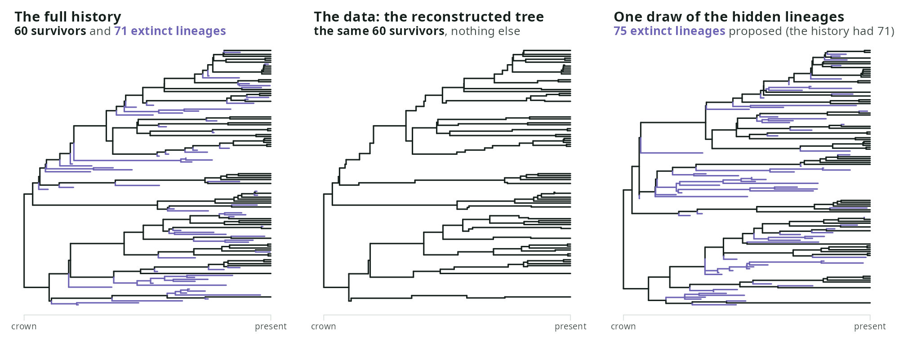

# emphasis

[](https://github.com/franciscorichter/emphasis/actions/workflows/R-CMD-check.yaml)
[](https://cran.r-project.org/package=emphasis)
[](./LICENSE)
[](https://franciscorichter.github.io/emphasis/)

**emphasis** fits birth-death models of species diversification to phylogenetic trees, where the speciation and extinction rate of each lineage depends on quantities the process generates itself: how many lineages are alive, how long a lineage has waited since it last split, how distinct it is on the tree, and how many splits lie in its ancestry.

A reconstructed phylogeny shows only the species alive today. Everything that went extinct is missing, and the rates depend on it. emphasis integrates over those hidden lineages: it samples them onto the observed tree, weights each sample by how well it explains the data, and estimates the rates by Monte Carlo expectation-maximisation.



*A clade simulated under diversity dependence. Left: everything that happened. Middle: the same tree with its extinct lineages removed, which is all a phylogeny of living species records. Right: one set of extinct lineages that emphasis's sampler proposes for that observed tree; a fit averages over hundreds of such draws.*

Version 1.1.0 is on CRAN (published 18 November 2026); `main` is 1.1.0.9000. Documentation: <https://franciscorichter.github.io/emphasis/>.

## Installation

```r
install.packages("emphasis")

# the development version, with the fixes listed in NEWS.md under 1.1.0.9000
# install.packages("devtools")
devtools::install_github("franciscorichter/emphasis")
```

The package compiles C++ code (Rcpp, RcppParallel, nloptr, BH), so a compiler is needed: Xcode command-line tools on macOS, Rtools on Windows.

## Quick start

```r
library(emphasis)

# simulate a clade under diversity dependence: lambda = 0.6 exp(-0.01 N), mu = 0.05
set.seed(1)
sim <- simulate_tree(pars = c(log(0.6), -0.01, log(0.05), 0), max_t = 10, model = "dd",
                     max_tries = 20)        # redraw until the clade survives
phy <- sim$tes                              # the reconstructed tree, an ape::phylo

# a parameter box for each model, from the tree alone
box_cr <- auto_bounds(phy, model = "cr", train_surv_gam = FALSE)
box_dd <- auto_bounds(phy, model = "dd", train_surv_gam = FALSE)

# fit constant rates and diversity dependence, then compare them
fit_cr <- estimate_rates(phy, model = "cr",
                         control = list(lower_bound = box_cr$lower_bound,
                                        upper_bound = box_cr$upper_bound, sample_size = 200))
fit_dd <- estimate_rates(phy, model = "dd",
                         control = list(lower_bound = box_dd$lower_bound,
                                        upper_bound = box_dd$upper_bound, sample_size = 200))
fit_dd                                      # estimates, log-likelihood, effective sample, stop reason
compare_models(cr = fit_cr, dd = fit_dd)    # AIC with the Monte Carlo diagnostics
```

On a desktop CPU (AMD Ryzen 9) this runs in about 7 minutes. In that run the simulated tree had 97 tips (the compiled simulator draws differently across platforms, so the tree may differ), `compare_models()` chooses `dd` by 4.2 AIC, and the estimate of $\beta_N$ is -0.0102 against the true -0.01.

## The model

Each lineage $s$ alive at time $t$ speciates at rate $\lambda(s,t)$ and goes extinct at rate $\mu(s,t)$:

$$
\lambda(s,t) = f\bigl(\beta_0 + \beta_N N(t) + \beta_D D_s(t) + \beta_{ED}\,\mathrm{ED}_s(t) + \beta_K K_s(t)\bigr),
\qquad
\mu(s,t) = f\bigl(\gamma_0 + \gamma_N N(t) + \dots\bigr)
$$

with $f = \exp$ (the default) or the linear link $f(x) = \max(0, x)$, chosen with `link = "exponential"` or `"linear"`.

| Covariate | What it measures | Biological question |
| --------- | ---------------- | ------------------- |
| $N(t)$ | the number of lineages alive | do ecological limits slow diversification? |
| $D_s(t)$ | the time since lineage $s$ last split, relative to the clade mean | do lineages that have waited longer speciate more or less? |
| $\mathrm{ED}_s(t)$ | evolutionary distinctiveness (fair proportion) on the complete tree | do isolated lineages diversify differently? |
| $K_s(t)$ | the number of speciation events in the ancestry of $s$ | does a speciation-rich ancestry carry on? |

$D$, $\mathrm{ED}$ and $K$ are read on the complete tree, hidden lineages included, so they need the tree's topology (a `phylo`). The [covariates page](https://franciscorichter.github.io/emphasis/covariates/) gives each one's definition and meaning.

Setting coefficients to zero gives the named models:

| Model | Covariates | Model | Covariates |
| ----- | ---------- | ----- | ---------- |
| `"cr"` | none (constant rates) | `"ed"` | $\mathrm{ED}$ |
| `"dd"` | $N$ (diversity dependence) | `"ned"` | $N + \mathrm{ED}$ |
| `"d"` | $D$ | `"edc"`, `"nedc"` | $\mathrm{ED}$ centred on the clade mean, alone or with $N$ |
| `"nd"` | $N + D$ | `"k"`, `"nk"` | $K$, alone or with $N$ |

A formula works too: `model = ~ N + D`, `~ N + ED`, `~ N + EDc`, `~ N + K`.

## What the package does

### Simulate trees

`simulate_tree()` runs the process forward under any model and link, and returns the reconstructed tree (`tes`), the complete tree with its extinct lineages (`tas`) and the L-table. A matrix of parameter rows gives one simulation per row, in parallel. Given an observed tree, it instead draws the hidden lineages from either of the package's two samplers.

```r
sim <- simulate_tree(pars = c(log(0.5), -0.02, log(0.1), 0), max_t = 10, model = "dd")
sim$status                           # "done", "extinct" or "too_large"
plot(sim$tes)

# hidden lineages for an observed tree: 50 draws with their log proposal density
aug <- simulate_tree(sim$tes, pars = c(log(0.5), -0.02, log(0.1), 0), model = "dd",
                     n_trees = 50, method = "bdi")        # or method = "thinning"
```

The [simulator page](https://franciscorichter.github.io/emphasis/simulator.html) runs the same forward process in the browser.

### Estimate rates

`estimate_rates()` fits one model by Monte Carlo EM. Each iteration draws hidden lineages for the observed tree (the E-step) and maximises the weighted complete-data likelihood (the M-step).

```r
box <- auto_bounds(phy, model = "dd", train_surv_gam = FALSE)   # parameter box from the tree alone
fit <- estimate_rates(phy, model = "dd",
                      control = list(lower_bound = box$lower_bound,
                                     upper_bound = box$upper_bound,
                                     sample_size = 200))
fit$pars; fit$loglik; fit$AIC
diagnose_mcem(fit)                                       # the trace of every iteration
```

- **Two samplers** for the hidden lineages: `"bdi"` (the default), which is exact under constant rates and a mean-field proposal otherwise, and `"thinning"`, which covers every model. Choose with `control$sampling`.
- **Starting point**: without `init_pars` a fit starts at the constant-rate maximum-likelihood estimate of the tree (closed form, conditioned on survival when `cond` is a function), with every covariate coefficient at zero. EM is slow in the extinction rate, whose information comes almost entirely from the imputed lineages, so the start matters: on 40 constant-rate trees (80–150 tips, λ = 0.5, μ = 0.2, conditioned on survival) the median distance to the exact estimate of μ is 0.002 from this start and 0.089 from the middle of the parameter box.
- **Three stopping rules**: `projected` (the default) stops when the relative step and the relative distance to the fixed point projected from the last 8 iterates both stay below `tol`; `rel_change` uses the step alone; `mc_error` grows the number of draws until the step is inside its own Monte Carlo noise. `max_iter` and `max_time` bound every fit. A small step does not mean the end is near: from the middle of the box, on 10 of those trees, `rel_change` stopped at a median of 20 iterations and `projected` at 59, closer to the exact μ on every tree and still off on 9 of 10 (0.363 against 0.407 on one). Under diversity dependence (10 trees, 69–134 tips) the new and the previous defaults end within 0.6 log-likelihood units of each other and of 1000-iteration reference fits. Check `diagnose_mcem(fit)` for a trace that is still drifting.
- **Conditioning on survival**: `cond = "surface"` conditions any model on the clade surviving to the present, through local surfaces of a simulated survival probability; `cond` also takes a function for an exact value.
- **Incomplete sampling**: `control$rho` is the fraction of living species in the tree; the sampler then also inserts unsampled living lineages.

### Choose a model

```r
# compare fits you made yourself
compare_models(cr = fit_cr, dd = fit_dd, nd = fit_nd)

# or fit the nested ladder cr, dd, nd, ned, nk in one call (five fits: on a 135-tip
# tree it had not finished after 50 minutes)
fits <- estimate_rates(phy, model = "all")
fits$comparison; fits$chosen
```

`compare_models()` reports AIC together with each fit's effective sample and its Monte Carlo gap, and warns when the ranking could be an artefact of sampling. Its `chosen` model is the one with the fewest parameters among those within 2 AIC of the best.

`covariate_path()` is exploratory: it follows a dgLARS path over all four covariates from one set of draws, on the Poisson form of the likelihood that `lineage_table()` exposes (one row per lineage and time segment). At a fitted `dd` estimate on 100-tip trees it named the generating covariate on at least 80% of trees in 1 of 28 simulated settings, with a median effective sample of 6.9 of 3000 draws ([V8](https://franciscorichter.github.io/emphasis/experiments/V8.html)), so it does not replace fitting the models.

### Read what a fit says about itself

A fit prints its effective sample, an indication of how far its log-likelihood sits below the truth, why it stopped, and notes when the data are thin: fewer than 50 tips for a lineage-level covariate, an effective sample below 10, turnover above 0.5. The reported log-likelihood is a log of a Monte Carlo mean, so it is biased downwards; `compare_models()` takes this into account when it ranks fits.

## Function reference

| Function | Purpose |
| -------- | ------- |
| `simulate_tree()` | forward simulation under every model and link; given a tree, draws of its hidden lineages |
| `estimate_rates()` | Monte Carlo EM for one model, or the nested ladder with `model = "all"` |
| `compare_models()` | AIC table with effective sample, Monte Carlo gap and the parsimonious choice |
| `covariate_path()` | the dgLARS path over the covariates, for speciation and extinction (exploratory) |
| `lineage_table()` | the per-lineage, per-segment table the likelihood is built on |
| `auto_bounds()` | a parameter box computed from the observed tree |
| `survival_mc()`, `survival_surface()` | the survival probability by direct simulation, and a local surface of it |
| `diagnose_mcem()` | the trace of a fit |
| `emphasis_pipeline()`, `train_GAM()`, `predict_survival()`, `diagnose_cem()`, `diagnose_gam()` | further estimators (cross-entropy, GAM surface) and a survival emulator, kept for compatibility |

Every argument is documented on the [reference page](https://franciscorichter.github.io/emphasis/reference.html) and in R (`?estimate_rates`).

## What to expect from a fit

Each statement below is a measurement on simulated trees with known generating values, from experiments whose rules were fixed before they ran, with the likelihood conditioned on survival. Several are still running; the [estimability page](https://franciscorichter.github.io/emphasis/experiments/estimability.html) carries the current numbers and [one page per experiment](https://franciscorichter.github.io/emphasis/experiments/) the design and data behind each.

- **Where an exact likelihood exists, MCEM reaches it.** Under constant rates the estimate sits at the exact conditioned maximum in every setting tested (25 to 800 tips); under diversity dependence in 11 of 14, and the three that miss stopped on their time limit ([E45](https://franciscorichter.github.io/emphasis/experiments/E45.html)).
- **Speciation is read from small trees, extinction from large ones.** Speciation is within a factor of 2 of the truth from 25 tips under constant rates and from 50 under diversity dependence. Extinction is not, at any size up to 800 tips, unless turnover is high; at turnover 0.4 it is from about 200 tips.
- **Lineage-level slopes are recovered in a minority of settings.** At 50 and 100 tips, 17 of 73 slope settings meet the recovery rule, mostly at 100 tips and low turnover; fit by fit the slope is within a factor of 2 of the truth on 71% of 1,481 fits, with the right sign on 90% ([V5](https://franciscorichter.github.io/emphasis/experiments/V5.html), interim; 200 and 400 tips are running).
- **The sampler sets the limit before the data do.** `ned`, `nedc`, `ed` with a negative effect, and the thinning sampler at high turnover keep about 10 effective draws or fewer; `d`, `edc` and `nd` on the default `"bdi"` sampler keep hundreds. A fit whose effective sample is below 10 says so when printed; treat its estimate as unread.
- **At about 100 tips, AIC does not invent a lineage-level effect and usually misses a real one.** No lineage-level model was chosen on any of 54 constant-rate or diversity-dependent trees; on trees generated with a lineage-level effect of ±0.35, the generating covariate's model was chosen on at least 80% of trees in none of 19 settings (at best 12 of 20) ([V7](https://franciscorichter.github.io/emphasis/experiments/V7.html)). Choosing `cr` or `dd` on a tree of this size does not rule out a lineage-level effect.
- **With nothing hidden, every model's likelihood returns the coefficients that generated the tree.**

On 175 bird and mammal phylogenies the same ladder chooses a lineage-level model on 35 of the 49 trees whose five fits all read (`ned` 17, `nk` 16, `nd` 2), with $\beta_K > 0$ on all 16 `nk` trees ([V11](https://franciscorichter.github.io/emphasis/experiments/V11.html)). Whether those choices reflect a lineage-level process or a feature of real trees that the simulations lack is not settled.

## Citation

```r
citation("emphasis")
```

Richter F, Haegeman B, Etienne RS, Wit EC (2020). Introducing a general class of species diversification models for phylogenetic trees. *Statistica Neerlandica* 74(3), 261–274. [doi:10.1111/stan.12205](https://doi.org/10.1111/stan.12205)

## Development

```r
devtools::load_all()    # compile src/ and load
devtools::document()    # NAMESPACE and man/ from roxygen
devtools::test()        # tests/testthat; NOT_CRAN=true runs the Monte Carlo tests too
devtools::check()       # R CMD check
```

CI runs `R CMD check` on macOS, Windows and Linux (R release, devel, oldrel) for every push to `main` and every pull request.

```
R/            the package's R code: simulate.R, inference.R (estimate_rates, compare_models),
              emphasis.R and bdi.R (MCEM and the two samplers), survival.R, covariate_path.R, ...
src/          C++: augmentation, E-step and M-step (TBB, NLopt), forward simulation
inst/include/ header-only model code shared by the simulator and the likelihood
tests/        testthat suite (42 files)
man/          generated by roxygen; man/figures/ holds the README figures
site/         sources of the docs site: build.py, Markdown pages, figure scripts
docs/         the docs site as built, served by GitHub Pages
dev/          the estimator's audit, the simulator check and research prototypes (not in the package)
```

**Tests.** 42 files. About 42,000 expectations pass with `NOT_CRAN=true` and about 2,300 in CRAN mode, where the Monte Carlo tests are skipped. Several check the C++ likelihood and samplers against computations written independently in R: closed forms, quadrature, brute-force marginal likelihoods on 2- to 4-tip trees, and `ape`'s tree quantities.

**Docs site.** `python3 site/build.py --wiki <experiments wiki checkout>` rebuilds every page into `docs/` from `site/src/*.md`, the function reference in `site/reference/` (made by `site/reference.R`) and the experiment pages, which come from a separate experiments repository. It fails on a broken internal link. A push to `main` publishes it.

**README figures.** `Rscript site/figures/readme.R` redraws `man/figures/readme-*.png` from the package; it runs in about a minute.

**Experiments and papers.** The simulation experiments (pre-registrations, drivers, results) and the two manuscripts that report them, one on the method and one on bird and mammal phylogenies, are in separate repositories that are not yet public; the experiment pages on the docs site are their public record.

## Authors

Francisco Richter (author, maintainer), franciscorichter@gmail.com. Thijs Janzen and Hanno Hildenbrandt contributed to an earlier C++ implementation, parts of which remain in `src/` and `inst/include/`.

## License

MIT. See [LICENSE](LICENSE).
